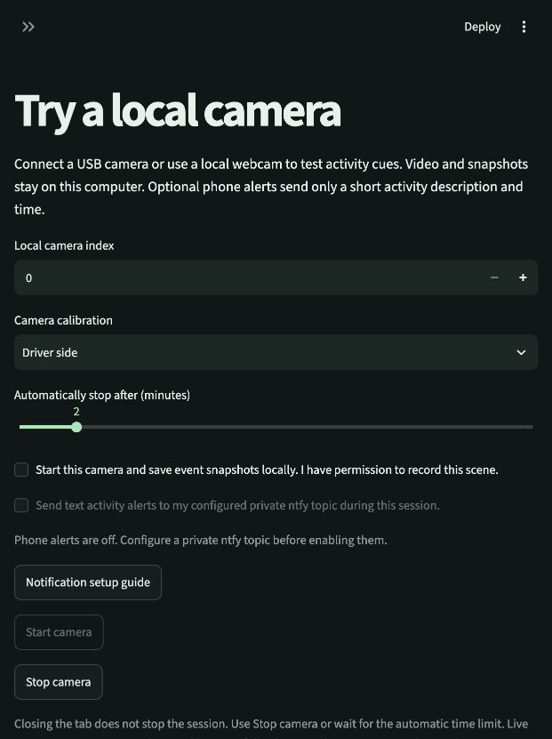
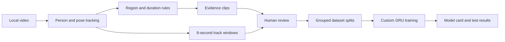

# Carwatch

**A local computer vision lab for understanding activity around parked cars.**

[](https://github.com/aaryapatel09/carwatch/actions/workflows/ci.yml)
[](#quick-start)
[](LICENSE)

Carwatch turns video into reviewable evidence: track people and estimated poses, define regions around a car, inspect activity cues, label short clips, and train an experimental sequence model. The Streamlit dashboard keeps this workflow on your computer.

**Research prototype.** Real-world safety performance has not been established. No custom model has been trained on real car-door activity. Activity cues describe observations; they do not establish intent, danger, or physical contact.

[Quick start](#quick-start) · [How it works](#how-it-works) · [Measured results](#models-and-measured-results) · [Documentation](#documentation) · [Contributing](CONTRIBUTING.md)

## What you can do

| Capability | Available today |
| --- | --- |
| Analyze recordings | Upload video and run local person/pose tracking at 4 samples per second. |
| Calibrate each view | Save ground and handle regions, a focused detection region, and activity thresholds. |
| Review evidence | Inspect timestamped images, silent event clips, track overlays, and detection gaps. |
| Build a dataset | Label 8-second windows and group recordings into train, validation, and test splits. |
| Train a custom model | Fit a small PyTorch GRU, inspect its model card, and evaluate a separate test split. |
| Try a live camera | Explicitly start and stop a local USB/webcam session with a 1–10 minute limit. Physical hardware is untested. |
| Send optional text alerts | Configure a private ntfy topic and opt in per live session. Transport is tested locally; phone receipt is unverified. |
| Manage local data | Export JSON/ZIP, batch-process recordings, and delete recordings or models. |

<details>
<summary>Interface preview: camera and notifications off</summary>

The live-camera setup screen below is from the running application. No camera is active and no notification service is configured.



</details>

## Quick start

Use **Python 3.11**, Git, and **ffmpeg**. This is a source checkout, not an installer or hosted service.

### 1. Install the media runtime

Run the command for your operating system:

```sh
# macOS, with Homebrew
brew install ffmpeg

# Ubuntu / Debian
sudo apt-get update
sudo apt-get install --no-install-recommends ffmpeg libgl1
```

### 2. Get the source

```sh
git clone https://github.com/aaryapatel09/carwatch.git
cd carwatch
python3.11 -m venv .venv
source .venv/bin/activate
```

### 3. Install dependencies

On **macOS**:

```sh
python -m pip install -r requirements.lock.txt
```

On **Linux with CPU inference** (also used by CI):

```sh
python -m pip install --no-deps --index-url https://download.pytorch.org/whl/cpu -r requirements-cpu.txt
python -m pip install -r requirements.lock.txt -c requirements-cpu.txt
```

### 4. Open the dashboard

```sh
python -m pip check
streamlit run app.py --server.port 8517
```

Open **[localhost:8517](http://127.0.0.1:8517)**. The checked-in configuration binds to `127.0.0.1`. First inference downloads pretrained model weights; source video stays local. Keep this unauthenticated research app on localhost.

No camera is needed to explore the dashboard or exercise synthetic training:

```sh
python demo.py
```

This trains on generated feature sequences only. See [the usage guide](docs/USAGE.md) for real-video analysis, labeling, batch commands, and model storage.

## How it works



The vision pipeline uses pretrained **YOLO11** and **ByteTrack**. Activity rules track sustained presence, repeated entries, and estimated wrists remaining in an image region. Custom models use 32-frame sequences with explicit missing-detection masks. Model scores do not automatically trigger alerts.

Live monitoring is a separate opt-in path: camera → pose tracking → activity rules → local snapshots and optional text delivery. Multiple recorded views can share a dataset group, but are processed independently; there is no synchronized live multi-camera system or cross-camera identity matching.

## Models and measured results

**What was trained:** a 32-unit GRU for 50 epochs on 192 generated sequences. This exercises training, checkpoint selection, and evaluation. The application prevents that synthetic model from scoring real recordings. Pretrained YOLO weights were not trained by this project.

**What real footage showed:** a public MEVA parking-lot development probe measured whether the detector matched supplied person boxes at IoU ≥ 0.5:

| Configuration | Matched annotated samples |
| --- | ---: |
| YOLO11n-pose, full image | 0 / 17 |
| YOLO11n-pose, focused region | 7 / 17 |
| YOLO11s-pose, same focused region | 9 / 17 |

These are 17 annotated samples from two interactions, not a general accuracy estimate. The region was selected after observing the initial failure. Unannotated frames were not treated as negatives, and no activity or false-alert benchmark was measured. See [data attribution, methodology, and reproduction commands](docs/PUBLIC-VIDEO.md).

**Software verification:** implementation commit [`08ac9e4`](https://github.com/aaryapatel09/carwatch/commit/08ac9e4d38569f728d5c4286d27f5023246769de) passed [112 tests and repository checks](https://github.com/aaryapatel09/carwatch/actions/runs/40427307711), plus [actual CV, clip export, and local HTTPS alert integration](https://github.com/aaryapatel09/carwatch/actions/runs/40427307257). Selected-module coverage was 87%. The badge above tracks current branch checks; software tests do not establish field reliability.

## Privacy and operating limits

- Recordings, labels, snapshots, and models stay in `runtime/`, which Git ignores. Set `CARWATCH_DATA_DIR` to an absolute path to choose another directory.
- Original recordings retain their audio; derived clips are silent. Local files are not encrypted by Carwatch.
- Camera access requires an explicit Start action. Closing the browser tab does **not** stop an active session; use Stop or the configured time limit.
- Optional alerts contain a fixed activity description and UTC time, with no media, camera names, location, or track IDs. A service acknowledgement does not confirm phone receipt. [Configure notifications](docs/NOTIFICATIONS.md).
- There is no face recognition, identity inference, weapon actuation, or automated emergency dispatch. An absence of alerts is not evidence that a scene is safe.

## Next milestones

The next work is intended-camera testing; permissioned, independently split recordings; real activity-model training; and measurements of event recall, false alerts per hour, delay, low light, and blind spots. Universal mounting, automotive power/heat/weather qualification, connectivity, and physical-phone delivery remain unverified. See the [readiness audit](docs/READINESS.md) and [proposed hardware test](docs/HARDWARE.md).

## Documentation

| Guide | Contents |
| --- | --- |
| [Usage and training](docs/USAGE.md) | First recording, labels, splits, batch CLI, and model artifacts |
| [Notifications](docs/NOTIFICATIONS.md) | Private-topic configuration, delivery states, and cancellation |
| [Testing](docs/TESTING.md) | Checks to run and what each establishes |
| [Verification record](VERIFICATION.md) | Dated evidence and regression fixes |
| [Public-video probe](docs/PUBLIC-VIDEO.md) | Reproducible MEVA measurement and attribution |
| [Readiness](docs/READINESS.md) | Implemented capabilities and missing field evidence |
| [Security](SECURITY.md) | Local access, data handling, and vulnerability reporting |

## Contributing

Bug fixes, reproducible tests, documentation improvements, and carefully scoped experiments are welcome. Start with [CONTRIBUTING.md](CONTRIBUTING.md). Use synthetic examples in issues and pull requests; keep recordings, credentials, and model weights out of Git.

## License and acknowledgements

Project code is licensed under **[AGPL-3.0-only](LICENSE)**. Libraries, pretrained weights, and datasets retain their own terms. No model weights or recordings are included in this repository.

Built with [Streamlit](https://github.com/streamlit/streamlit), [Ultralytics YOLO](https://github.com/ultralytics/ultralytics), [PyTorch](https://github.com/pytorch/pytorch), [OpenCV](https://github.com/opencv/opencv), and [FFmpeg](https://ffmpeg.org/). Ultralytics has [AGPL / enterprise licensing conditions](https://www.ultralytics.com/license). The optional integration replay uses a photo from the installed Ultralytics package. The optional public probe uses [MEVA](https://mevadata.org/) by Kitware Inc. and IARPA under [CC BY 4.0](https://mevadata.org/resources/MEVA-data-license.txt).
